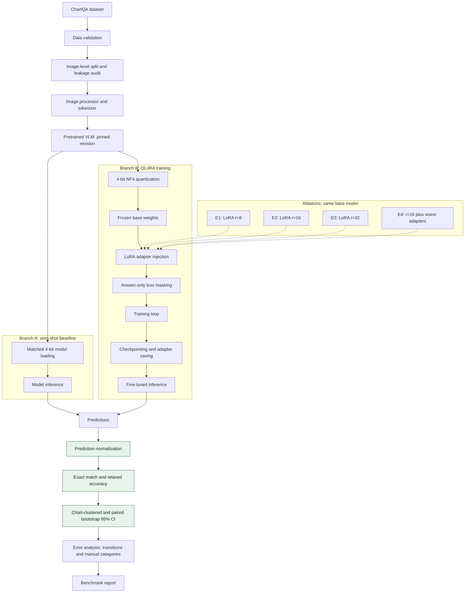
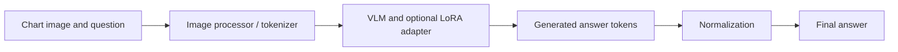

# ChartQA VLM QLoRA

An engineering mini-project investigating parameter-efficient adaptation of a small vision-language model for chart question answering.

**Status:** data and evaluation utilities are implemented and CPU-tested. Offline prediction scoring and paired error reports are runnable. Model selection, dataset ingestion, inference, QLoRA training, checkpoint recovery, and E0–E4 experiments remain pending. No model accuracy or training-performance results have been measured. See the [repository audit](docs/REPOSITORY_AUDIT.md) and [engineering checklist](TASKS.md).

## Project Overview

Chart question answering maps a chart image and a question to an answer. It combines text recognition, axis and legend interpretation, value extraction, and arithmetic. Small VLMs can lose fine visual detail under image compression and produce fluent answers without correctly reading the chart. The [ChartQA paper](https://aclanthology.org/2022.findings-acl.177/) motivates evaluating visual and logical reasoning together.

This project investigates QLoRA within a modest GPU budget, emphasizing immutable image-level splits, answer-only supervision, comparable decoding, uncertainty estimates, and auditable artifacts. NVIDIA TAO is workflow inspiration only; there is no TAO integration.

## Research Questions

| Question | Controlled comparison |
|---|---|
| RQ1: Does QLoRA improve ChartQA accuracy over zero-shot inference? | E2 versus E0, paired on the same questions |
| RQ2: How does LoRA rank affect accuracy, training cost, and GPU memory? | E1/E2/E3, constant alpha/rank ratio |
| RQ3: Does adapting the vision encoder help? | E4 versus E2, adding vision adapters |
| RQ4: What errors remain after fine-tuning? | Paired failures with manual image-grounded annotation |
| RQ5: What are the accuracy, latency, memory, and cost trade-offs? | Matched quality and systems measurements |

## Model and Dataset

**No model or revision has been finalized.** `configs/base.yaml` retains its original placeholders; it is a design sketch, not an executable recipe. Select one base model for E0–E4 only after processor, NF4, adapter-target, and one-batch backward checks.

| Candidate | Reason to evaluate | Selection risk |
|---|---|---|
| [HuggingFaceTB/SmolVLM-500M-Instruct](https://huggingface.co/HuggingFaceTB/SmolVLM-500M-Instruct) | First feasibility candidate for the observed 6 GiB GPU | Chart text/detail and reasoning quality unmeasured |
| [HuggingFaceTB/SmolVLM-Instruct](https://huggingface.co/HuggingFaceTB/SmolVLM-Instruct) | Larger SmolVLM alternative with processor examples | Training activation memory unverified |
| [Qwen/Qwen2-VL-2B-Instruct](https://huggingface.co/Qwen/Qwen2-VL-2B-Instruct) | ChartQA evaluation in its card; dynamic image resolution | Visual token count and memory require control |

These are candidates, not local benchmark results. Pin the selected immutable revision, processor/tokenizer revision, chat template hash, image settings, license, and dependency environment. Upstream scores are not results of this repository.

Dataset source: [original ChartQA](https://github.com/vis-nlp/ChartQA); candidate distribution: [HuggingFaceM4/ChartQA](https://huggingface.co/datasets/HuggingFaceM4/ChartQA), exposing `image`, `query`, `label` (list), and `human_or_machine`. The local loader remains a stub; no data have been downloaded. Preserve raw answers and reject unexpected multiple labels until an explicit policy exists.

Use seed **42**. Preserve official split membership and audit overlap before subsampling each split. Derive chart IDs from canonical image pixels plus dimensions, not question IDs or split-local filenames. Quarantine cross-split duplicates before locking manifests; record exclusions. The existing `split_by_image` groups supplied IDs, deterministically shuffles, and fills test, validation, then training up to approximate question caps. It can leave groups unassigned and does not detect content duplicates. Use it only for a custom development pool, never to reshuffle official test charts into training.

The YAML proposes 4,000/300/1,000 question caps; actual counts are **Pending**. Decode RGB and use the selected processor without silent OCR-damaging resizing. `max_pixels: 313600` is unvalidated and model-specific. Save dimensions, image hashes, exclusions, chart/question counts, answer types, and human/generated counts.

## System Architecture and Training Pipeline

This is the **target architecture**, not completed integration. Green nodes are tested offline utilities; other nodes need model/data integration or implementation.



Inference workflow (model execution pending):



| Module | Actual responsibility |
|---|---|
| `src/data.py` | Group splitting and prefix label masking; dataset loader is a stub |
| `src/eval.py` | Normalization, EM/relaxed scoring, individual and paired clustered bootstrap |
| `src/report.py` | Validate saved predictions, align paired samples, emit metrics and review CSV |
| `src/utils.py` | YAML parsing and seeds; no config schema validation |
| `src/train.py` | Argument parsing; training raises `NotImplementedError` |
| `tests/` | CPU unit and offline CLI integration tests; no VLM training test |
| `results/` | Contracts and empty templates; no measured model results |
| `notebooks/` | Empty placeholder |

## Training Methodology

**Planned, not implemented end to end.** QLoRA freezes low-precision base weights and trains low-rank updates scaled by `alpha / r`. Intended loading uses bitsandbytes NF4, double quantization, and FP16 compute where supported. Storage precision does not imply 4-bit activations or optimizer states. See [Transformers quantization](https://huggingface.co/docs/transformers/quantization/bitsandbytes).

| Setting | Current sketch / planned implementation |
|---|---|
| Adapter | Rank 16, alpha 32, dropout 0.05; E1/E3 change rank and alpha together |
| Targets | YAML suggests `q_proj`, `v_proj`; enumerate exact language paths before use |
| Frozen weights | All base weights, vision encoder, projector for E1–E3; train LoRA only |
| E4 | Add rank-16 vision adapters; keep base weights and projector frozen |
| Loss | Ignore prompt, image, padding, non-answer special tokens with `-100`; retain answer and intended EOS |
| Batch | 1 sample/device × 16 accumulation × 1 device = nominal effective batch 16 |
| Precision | FP16 proposed; check finite gradients; no BF16 assumption |
| Optimizer | AdamW proposed, LR 2e-4; betas, decay, scheduler, warmup to be frozen before experiments |
| Duration | One epoch proposed; same data/order/step budget across ablations |
| Memory | Gradient checkpointing proposed; disable training cache |
| Selection | Validation relaxed accuracy only |
| Persistence | Full training checkpoints and separate adapter exports; pending |

`mask_prompt_labels` masks only a supplied prefix. It is **not** a multimodal collator: token boundaries, padding, image tokens, truncation, and EOS require processor-specific tests. Assert frozen weights stay fixed and log trainable names/counts. An adapter alone cannot resume training: verify step, optimizer, scheduler, scaler, RNG, and sampler recovery.

## Experimental Design

E0–E4 are configurations of **one** base VLM. E0 uses the same quantized base as adapted inference to isolate adaptation from precision changes.

| ID | Experiment | Rank / alpha | Adapted modules | Status |
|---|---|---|---|---|
| E0 | Zero-shot pretrained VLM | None | None | Not run |
| E1 | Small adapter | 8 / 16 | Language attention targets | Not run |
| E2 | Main QLoRA experiment | 16 / 32 | Same language targets | Not run |
| E3 | Larger adapter | 32 / 64 | Same language targets | Not run |
| E4 | Vision adaptation | 16 / 32 | E2 plus supported vision targets | Not run |

MVP: E0 and E2 first; E1/E3 next; E4 after feasibility checks. Lock the test manifest, answer extraction, normalization, greedy decoding (`do_sample=False`, one beam, max 32 new tokens), processor, and evaluator version. Use validation for selection; test only after freezing configurations. See the [experiment plan](docs/EXPERIMENT_PLAN.md).

## Evaluation Methodology

Implemented protocol **`chartqa_local_v1`** follows ChartQA's 5% relative-error idea with explicit local formatting rules. It is not a byte-for-byte official leaderboard scorer.

- **Normalization / EM:** require strings; trim/collapse whitespace, lowercase, remove one terminal sentence period while preserving ellipses. Keep other punctuation, signs, `%`, and numeric formatting. EM averages normalized equality: `1,000` vs `1000` fails EM; `Yes.` vs `yes` passes.
- **Relaxed accuracy:** parse complete finite numeric strings with valid thousands groups, decimal/exponent notation, and one optional trailing `%`. Percentages divide by 100: `50%` matches `0.5`, not `50`. For nonzero gold `g`, accept `abs(p-g)/abs(g) <= 0.05`; for zero gold, numeric zero only. Nonnumeric answers use EM. Lists, units, currency, fractions, and explanations are not reduced to a convenient number. The percentage convention follows the [Pix2Struct reference](https://github.com/google-research/pix2struct/blob/main/pix2struct/metrics.py); zero, punctuation, comma, and validation rules are explicit local deviations.
- **Uncertainty:** resample chart IDs with replacement and include all questions in each sampled chart. Compute question-weighted accuracy with percentile 2.5/97.5 endpoints over 1,000 replicates, seed 42. The Python API permits question-level bootstrap without IDs; the CLI always requires chart IDs.
- **Paired comparison:** align unique sample IDs, verify chart/question/gold equality, and bootstrap within-chart score differences using shared chart draws. Report adapted-minus-baseline differences and 95% CIs for both metrics. Few charts give weak intervals; bootstrap does not capture training-seed variation.

JSON scores are fractions; displayed deltas are percentage points. The CLI checks paired file equality but cannot detect samples omitted from both files without an external manifest audit.

## Results

No model experiments have run. Artificial test fixtures are software checks, never benchmark evidence.

### Model Quality Comparison

| Experiment | Exact Match | Relaxed Accuracy | 95% CI | Δ vs Baseline |
|---|---|---|---|---|
| E0 | Pending | Pending | Pending | Pending |
| E1 | Pending | Pending | Pending | Pending |
| E2 | Pending | Pending | Pending | Pending |
| E3 | Pending | Pending | Pending | Pending |
| E4 | Pending | Pending | Pending | Pending |

### Systems Performance

| Experiment | Training Time | Peak VRAM (train / inference) | GPU-hours | Inference P50 | Inference P95 |
|---|---|---|---|---|---|
| E0 | Not applicable | Not measured / Not measured | Not measured | Not measured | Not measured |
| E1 | Not measured | Not measured / Not measured | Not measured | Not measured | Not measured |
| E2 | Not measured | Not measured / Not measured | Not measured | Not measured | Not measured |
| E3 | Not measured | Not measured / Not measured | Not measured | Not measured | Not measured |
| E4 | Not measured | Not measured / Not measured | Not measured | Not measured | Not measured |

### Ablation Analysis

| Changed Component | Accuracy Change | Memory Change | Time Change | Interpretation |
|---|---|---|---|---|
| E2 vs E0: adaptation | Pending | Not measured | Not measured | Pending evidence |
| E1 vs E2: rank 8 vs 16 | Pending | Not measured | Not measured | Pending evidence |
| E3 vs E2: rank 32 vs 16 | Pending | Not measured | Not measured | Pending evidence |
| E4 vs E2: vision adapters | Pending | Not measured | Not measured | Pending evidence |

Use [results contracts/templates](results/README.md). Keep training and inference memory separate. Plots await measured runs.

## Error Analysis

Offline reports export **fixed**, **remaining**, **new**, and **both_correct** transitions using relaxed accuracy. Review CSVs include image/sample ID, question, gold, both predictions, category, and notes. Categories require manual chart inspection: incorrect value extraction; arithmetic/aggregation; small-text recognition; legend/axis misunderstanding; reasoning across multiple points; output formatting; unsupported/hallucinated answer.

The [experiment plan](docs/EXPERIMENT_PLAN.md) defines annotation and sampling. Real representative examples and category conclusions are **Pending**. Correctness transitions alone do not establish which reasoning skill improved.

## Reproducibility

Run from the repository root. Verification used the existing Windows `.venv`; activate with `.\.venv\Scripts\Activate.ps1`. Elsewhere create/activate a local Python 3.11 environment.

Lightweight setup (no models downloaded):

```bash
python -m pip install -r requirements-dev.txt
python -m pytest -q
python -m compileall -q src tests
python -m src.report --help
python -m src.train --help
```

`requirements.txt` retains the original unpinned ML dependencies. Installing it is optional for future model work and may download large packages. It is not a validated lockfile. The [audit](docs/REPOSITORY_AUDIT.md) records observed versions; freeze the full environment after the selected model passes smoke tests.

Offline evaluation of **existing** predictions (these are user-supplied paths, not bundled data):

```bash
python -m src.report --predictions outputs/E0/predictions.jsonl --output-dir outputs/E0/report
python -m src.report --predictions outputs/E2/predictions.jsonl --baseline outputs/E0/predictions.jsonl --output-dir outputs/E2/report
```

Implemented commands emit `metrics.json`, `summary.md`, and paired `errors.csv`. Destinations must be new, protecting existing results. Regenerate into a new directory with identical inputs/seed. See [input/output contracts](results/README.md).

**Model inference has no runnable command yet. Training is a stub:** `python -m src.train --config configs/base.yaml` raises `NotImplementedError`. Dataset preparation, resume, adapter inference, and systems benchmarking commands are not implemented. Their acceptance gates are in [TASKS.md](TASKS.md).

Future runs must save resolved config, code commit/dirty diff, model/data revisions, split hash, environment, hardware, raw predictions, timing boundaries, checkpoints, and adapter metadata. Seeds do not guarantee deterministic GPU kernels or cross-version reproduction.

## Limitations and Future Work

Utility tests do not verify VLM learning. Model compatibility, memory fit, end-to-end masking, stability, and checkpoint recovery remain untested. The local metric differs from upstream scorers. Grouping IDs does not detect image duplicates. YAML loading has no schema validation; dependencies are unpinned. Pretraining exposure to ChartQA may confound generalization claims despite clean fine-tuning splits. One subset/model/seed cannot establish broad superiority.

Next implement a pinned data/model path, E0 inference, then an overfit-and-resume test before E2. Rank/vision ablations, multiple seeds, plots, and a second foundation model follow only if resources permit. Distributed infrastructure is outside MVP scope.

## Interview Takeaways

Explain image leakage prevention, model-specific loss masks, frozen versus trainable parameters, a fair quantized baseline, and paired chart-level uncertainty. Distinguish implemented utilities from experimental evidence; describe checkpoint recovery and GPU benchmarking as acceptance requirements. [CV bullets](docs/CV_PROJECT_BULLETS.md) separate verified work from ongoing and potential achievements.
